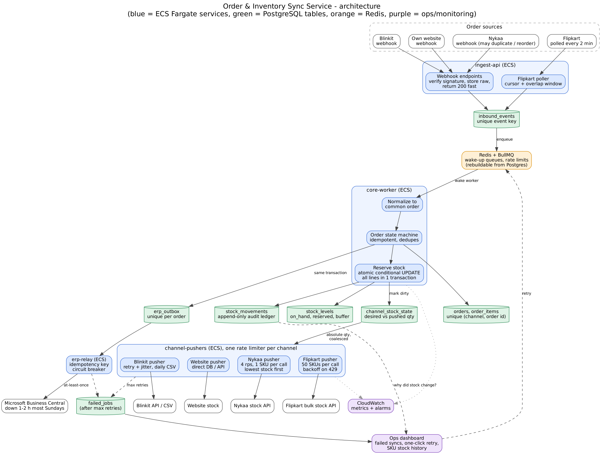

# Order & Inventory Sync Service

**Core idea:** PostgreSQL is the source of truth for sellable stock. Order reservations use an atomic conditional update. Durable event, stock-publish and ERP work is recorded in PostgreSQL before acknowledgement; Redis/BullMQ only wakes workers and enforces rate limits, and its jobs can be rebuilt from PostgreSQL after a Redis loss.

## Architecture



*Source: [`architecture.dot`](architecture.dot) (Graphviz). Blue = ECS Fargate services, green = PostgreSQL tables, orange = Redis, purple = ops/monitoring.*

**Where it runs:** one NestJS codebase deployed as separate ECS Fargate services (`ingest-api` incl. Flipkart poller, `core-worker`, `channel-pushers`, `erp-relay`) plus a small ops dashboard behind an ALB; RDS PostgreSQL, ElastiCache Redis, and CloudWatch. Separate worker pools and rate limiters isolate channel failures. Multi-AZ RDS and autoscaling on backlog age are proposed; validate instance sizing and total cost against the ₹50,000/month cap (AWS pricing calculator) before committing to HA sizes. No Kafka, SQS or EKS in v1.

**Load check:** peak is about 300 orders/min, roughly 5 orders/s, each a short transaction touching a few rows. PostgreSQL handles this comfortably, so no sharding or stock cache is needed.

## Data model

| Table | Key columns and constraints |
|---|---|
| `inbound_events` | channel, external order ID, event ID/type, event time, raw payload, processing state; unique provider event key (fallback: order + event type + payload hash). Durable webhook/poll inbox. |
| `orders` | internal UUID, channel, external order ID, state, event/version metadata, ERP state; unique `(channel, external_order_id)`. |
| `order_items` | order ID, SKU, quantity, price; FK, `CHECK (qty > 0)`. |
| `stock_levels` | SKU PK, `on_hand`, `reserved`, `buffer`; check `0 <= reserved <= on_hand`; available is `on_hand - reserved`. |
| `stock_movements` | SKU, signed delta, reason, order/source event, actor, timestamp, resulting balance/version; append-only, unique source key for each applied effect. |
| `channel_stock_state` | `(channel, SKU)` PK, desired quantity/version, pushed quantity/version, dirty time, attempts/error. Coalesces updates to the latest absolute quantity. |
| `erp_outbox` / `failed_jobs` | job ID, kind/ref, idempotency key, state, attempts, next retry, last error. Unique ERP key per internal order; failed jobs feed the ops retry screen. |

**Avoiding duplicate orders:** raw event dedupe plus the unique order key handles repeated webhooks and racing workers. Every received event is kept for audit, even if duplicate or stale. Inventory movement, order-state change, and outbox insertion happen in one database transaction.

## Ingestion and inventory consistency

- **Webhooks:** verify signature/shared secret, persist the raw event, then acknowledge. If persistence fails, return a retryable error. Normalize asynchronously; never call ERP or channel APIs inside the webhook request.
- **Flipkart:** poll at the 2-minute minimum using a stored cursor with overlap. Persist each page idempotently before advancing the cursor. Reconcile periodically to catch missed pages.
- **Channel down:** other channels are unaffected because each has its own endpoint, worker pool and circuit breaker. Gaps are closed by the next poll or daily reconciliation.
- **Duplicates and ordering:** unique keys make duplicate delivery harmless. Store events and apply only legal state transitions using provider version/time where available. A cancel received before create is retained as a tombstone, and a late create must not resurrect a cancelled order. Contradictory sequences go to reconciliation rather than being silently ignored.
- **Reservation:** for an order, sort SKU lines and, in one transaction, run `UPDATE stock_levels SET reserved = reserved + qty WHERE sku = ? AND on_hand - reserved >= qty`. If any line updates zero rows, roll back all lines and mark the order `REJECTED_NO_STOCK`. Otherwise write ledger rows, confirm the order, dirty the affected channel stock, and create the ERP job. Sorted SKU locking prevents deadlocks on multi-line orders.

```ts
// Pseudo-code: reservation (one DB transaction per order)
async function reserve(order) {
  return db.transaction(async (tx) => {
    for (const line of sortBy(order.items, 'sku')) {
      const r = await tx.query(
        `UPDATE stock_levels SET reserved = reserved + $2
          WHERE sku = $1 AND on_hand - reserved >= $2`, [line.sku, line.qty]);
      if (r.rowCount === 0) throw new OutOfStock(line.sku);   // rolls back every line
      await tx.insert('stock_movements', { sku: line.sku, delta: -line.qty, reason: 'ORDER', orderId: order.id });
      await tx.markDirty('channel_stock_state', line.sku);     // triggers channel pushes
    }
    await tx.insert('erp_outbox', { orderId: order.id });      // same transaction
  });
}
```

**Last-unit race:** with one unit available, simultaneous Nykaa and Flipkart orders execute conditional updates on the same PostgreSQL row. PostgreSQL serializes the updates: one reserves the unit; the waiting update rechecks the condition and affects zero rows. Only the winner is confirmed internally and sent to the ERP; the loser is marked `REJECTED_NO_STOCK` and cancelled at its channel with a stock reason. This guarantees two internal orders never consume one unit.

**Residual risk (stale channel stock):** a marketplace can accept an order against a stale quantity before our update reaches it, and no design can atomically retract an already accepted checkout across independent APIs. We reduce the risk with a per-SKU safety buffer (channels see `max(0, available - buffer)`, with a higher buffer for fast-moving SKUs) and prioritized low-stock pushes, and we monitor stockout cancellations against the <0.5% sale-day target. This is a measured risk, not an absolute guarantee.

**Capacity limit:** a hard 60-second promise for every SKU is impossible if more distinct SKUs change per minute than Nykaa allows (about 240 calls/min at our 4 rps budget, 1 SKU per call). We coalesce updates, push low-stock/hot SKUs first, and alert on dirty-row age. At normal load this is expected to suffice; validate against observed change rates.

**Cancellations and returns:** a cancellation releases its reservation once, using a unique ledger source key. At dispatch, both `on_hand` and `reserved` decrease. A return is restocked only after warehouse receipt/inspection. State checks and event dedupe prevent duplicate cancels/returns from adding stock twice.

## Stock push and failures

The pusher reads dirty `(channel, SKU)` desired state and writes the absolute quantity, then marks that version successful. If the quantity changes during a request, the newer version stays dirty. This coalesces repeated changes and makes retries safe.

| Channel | Approach |
|---|---|
| Website | Direct DB/API update; owned path. |
| Nykaa | One SKU per call, token bucket at 4 requests/sec (about 240/min, headroom under the 5/sec limit); lowest stock first, then oldest dirty. |
| Flipkart | Batch up to 50 SKUs, cap at 10 requests/sec; honor 429/`Retry-After` and back off. |
| Blinkit | Urgent REST update with timeout, bounded retry and jitter; retry the same absolute quantity after an ambiguous timeout. Generate the daily CSV from current truth as reconciliation/fallback. |

**Failure handling:** channel queues and circuit breakers are isolated. ERP order jobs stay in PostgreSQL during Sunday downtime and drain after recovery, while reservation and ingestion continue. Retries use exponential backoff with jitter and keep the same ERP idempotency key. Retries alone cannot guarantee exactly-once HTTP delivery: Business Central must accept the internal order ID as a unique external reference, or allow lookup by it before retrying after an ambiguous timeout. If neither is supported, state that limitation and reconcile before replay. Poison jobs move to `failed_jobs` after bounded attempts; ops sees the error and history and can retry with an audit record. Daily reconciliation compares channel orders, local records, ERP references, and stock snapshots.

## Operations, assumptions, trade-offs

**Day-one metrics/alerts:**
1. Stockout rejections/cancellations as % of orders (target <0.5%).
2. Dirty SKU count and oldest stock-push age by channel (warn before 60 s).
3. ERP pending count, oldest age, and confirmed-to-ERP latency.
4. Webhook latency, poll cursor lag, duplicate/error rates.
5. Provider 429/timeout rates, dead-job count, DB lock/transaction latency, and monthly spend.

**Assumptions:** stable external order IDs and provider event IDs or usable payloads; channel APIs set absolute quantities; common SKU mapping across channels and ERP; webhooks can be authenticated; "confirmed" means payment complete or COD accepted; warehouse adjustments are audited; returns are sellable only after inspection; Blinkit's CSV is accepted daily and its urgent API is available. Provider outages are excluded from the normal-load 60-second target. Customer/PII retention and recovery objectives need confirmation.

| Decision | Chosen | Rejected | Why |
|---|---|---|---|
| Stock authority | PostgreSQL conditional update + ledger | Redis counters | Atomic reservation, durable audit, multi-line transaction. |
| Async delivery | PostgreSQL inbox/outbox; Redis/BullMQ as worker wake-up | Direct synchronous fan-out / Kafka | No lost work on crash, simpler v1 operations; queue can be rebuilt from the DB. |
| Channel stock | Desired-vs-pushed absolute state, coalescing | Delta events per stock change | Latest state is retryable/idempotent and avoids redundant API calls. |
| Runtime | ECS Fargate | EKS/Lambda | Small team, predictable worker pools, lower operational burden. |
| Oversell risk | Safety buffer + fast prioritized pushes | Equal stock on every channel with no buffer | Reduces stale-listing exposure; avoids promising impossible cross-channel atomicity. |

**V1 excludes:** second warehouse, forecasting/dynamic buffers, automated return inspection, full reconciliation UI, and the LLM assistant. Use an audited manual restock/adjustment flow and a reconciliation report first. A second warehouse would add `warehouse_id` to inventory and ledger, select a warehouse during reservation (e.g. by pincode), and send that location to the ERP.

**AI usage:** I talked the design through with Claude and OpenAI Codex across several topics (the stock-reservation race, channel rate limits, ERP idempotency, failure handling).